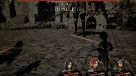

# TeamProject_33

- Unreal Engine 5.3 기반의 Clair Obscur: Expedition 33 모작 프로젝트입니다. 학습을 목적으로 진행한 팀 프로젝트이며, 사용된 일부 에셋은 본 저장소에 포함되어 있지 않습니다.
- 본 저장소에는 원본 프로젝트에서 제가 직접 작성한 코드만 포함되어 있으며, 해당 코드는 `Workspace/KHB`에 정리되어 있습니다.

## 프로젝트 소개

- 장르: 턴제 멀티플레이 전투
- 개발 기간: 2026.05.21 ~ 2026.06.21
- 팀 구성: 3인 팀 프로젝트

## 영상 / 발표 자료

- [담당 기능 시연 영상 보기](https://youtu.be/WoiXNQ9jrm4)
- [포트폴리오 PPT 보기](https://canva.link/bu8kbpknpg09r7a)

## 팀원 소개

- 최영우: 전투 카메라 · 연출 · 전투 UI
- 김현빈: 멀티플레이 접속 · 던전 전환 · 턴제 전투 · QTE 시스템
- 최우석: 몬스터 AI · 전투 컴포넌트 · 애니메이션 노티파이

## 담당 역할

- **멀티플레이 접속 시스템:** 메인 메뉴·서버 목록·로비와 플레이어·캐릭터 관리 구현
- **던전 전환 시스템:** 레벨 스트리밍 기반 던전 입장·복귀와 멀티플
- 레이 전환 처리
- **턴제 전투 시스템:** 턴 진행·전투 상태 관리와 패링·카운터 연계 구현
- **QTE 시스템:** 공격 애니메이션에 맞춘 QTE 시작과 입력 타이밍 판정, 판정 결과의 전투 반영 구현

## 기술 스택

### 개발

- C++
- Unreal Engine 5.3

### 협업

- Git/GitHub
- Discord

## 참고

- 이 저장소는 코드와 프로젝트 문서 열람용이며, 게임 실행에 필요한 에셋과 의존 코드는 포함하지 않습니다. 따라서 **Unreal에서 실행하거나 패키징할 수 없습니다**.
- 실제 동작 화면과 설명은 **페이지 상단 포트폴리오**를 참고해 주세요.
